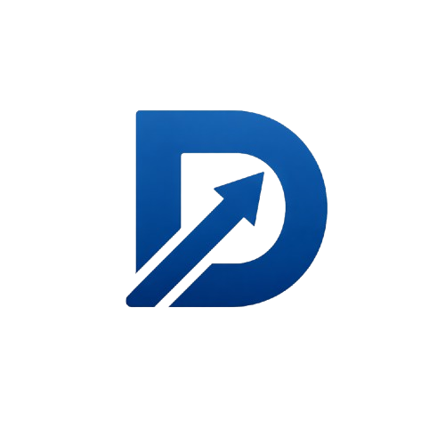

<div align="center">
    
    <h1>D-BOOST Core Web</h1>
    <p><strong>Digital Business Optimization & Operations System for UMKM</strong></p>
    <p>
        <a href="#-features">Features</a> •
        <a href="#-tech-stack">Tech Stack</a> •
        <a href="#-installation">Installation</a> •
        <a href="#-license">License</a>
    </p>
</div>

---

**D-BOOST** is a comprehensive, modular business intelligence and management platform designed specifically for Small and Medium Enterprises (UMKM). It empowers business owners with data-driven insights, streamlined operations, and AI-assisted decision-making.

Built with performance, scalability, and user experience in mind, D-BOOST transforms traditional business management into a modern, digital-first experience.

## Key Features

### Advanced Analytics & Dashboard
- **Real-time Overview**: Instant visibility into total sales, profit trends, and active customers.
- **Financial Reports**: Consolidated Profit & Loss statements and Cash Flow analysis.
- **Visual Insights**: Interactive charts using Chart.js for sales trends and performance metrics.

### Deby AI Assistant
- **Smart Support**: Integrated AI chatbot ("Deby") to assist with business queries and platform navigation.
- **Context Aware**: Intelligent responses based on your business context.

### Comprehensive Business Management
- **Product & Inventory**: Complete product catalog management, stock tracking (Stock In/Out), and inventory transactions.
- **Sales & Expenses**: Detailed recording of sales transactions and operational expenses.
- **Customer CRM**: Advanced customer management including loyalty programs, segmentation, and feedback tracking.

### Security & Control
- **Role-Based Access Control (RBAC)**: Granular permission system with definable Roles, Menus, and Modules.
- **Audit Logging**: Complete accountability with detailed audit trails for all critical actions.
- **Secure Authentication**: Robust user authentication and session management.

## Tech Stack

- **Backend**: Laravel 12.x
- **Frontend**: Blade Templates, TailwindCSS, Alpine.js
- **Database**: MySQL / PostgreSQL (Support for UUIDs)
- **AI/ML**: Python (Llama integration for Deby AI)
- **Assets**: Vite for bundle optimization
- **UI Components**: Heroicons, Custom Glassmorphism Design

## Prerequisites

Before setting up the project, ensure your environment meets the following requirements:

- **PHP**: 8.2 or higher
- **Composer**: Latest version
- **Node.js & NPM**: For frontend asset compilation
- **Database**: MySQL 8.0+ or PostgreSQL 13+

## Installation Standard

1. **Clone the Repository**
   ```bash
   git clone <repository-url>
   cd d-boost-core-web
   ```

2. **Install Dependencies**
   ```bash
   composer install
   npm install
   ```

3. **Environment Setup**
   ```bash
   cp .env.example .env
   php artisan key:generate
   ```
   *Configure your database credentials in the `.env` file.*

4. **Database Migration**
   ```bash
   php artisan migrate --seed
   ```

5. **Build Assets**
   ```bash
   npm run build
   ```

6. **Start Application**
   ```bash
   php artisan serve
   ```

## Design Philosophy

D-BOOST adopts a **modern, darkness-themed UI** optimized for visual comfort and professional aesthetics.
- **Glassmorphism**: Elegant translucent cards and overlays.
- **Primary Accent**: Lightning Green (#00FF9C) for high-visibility actions.
- **Typography**: Inter/Poppins for maximum readability.
- **Mobile-First**: Fully responsive layouts that work seamlessly on desktop, tablet, and mobile devices.

## Contributing

We welcome contributions to improve D-BOOST!
1. Fork the repository.
2. Create a feature branch (`git checkout -b feature/AmazingFeature`).
3. Commit your changes (`git commit -m 'Add some AmazingFeature'`).
4. Push to the branch (`git push origin feature/AmazingFeature`).
5. Open a Pull Request.

## License

This project is licensed under the MIT License - see the [LICENSE](LICENSE) file for details.
